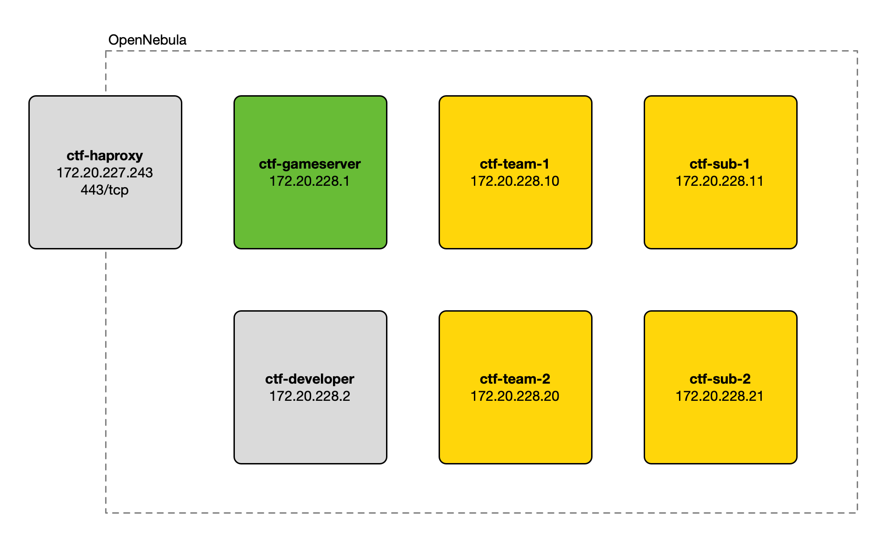

# CTF Gameserver en OpenNebula

Configuración de [CTF Gameserver](https://github.com/fausecteam/ctf-gameserver) en OpenNebula.

## Puesta en marcha

1. Crear y configurar los ficheros `terraform/variables.tf` y `ansible/gameserver/variables.yml` a partir de los de
   ejemplo.
2. Desplegar las máquinas virtuales:

    ```
    make build init apply
    ```

3. Entrar en el workspace:

    ```
    make workspace
    ```

4. Desplegar los escenarios que hayamos dejado en `/services` (instala los servicios y los checkers):

   > Ajustar el número de equipos en el fichero `hosts.ini`.

    ```
    make deploy
    ```

   > También se pueden lanzar las acciones `services` y `checkers` por separado.

5. Acceder al interfaz web del gameserver y crear el juego.

## Estructura de servidores



## Referencias

- [Installation - CTF Gameserver](https://ctf-gameserver.org/installation/)
- [CTF Gameserver](https://github.com/fausecteam/ctf-gameserver)
- [CTF Gameserver Ansible](https://github.com/fausecteam/ctf-gameserver-ansible)
- [Servir Aplicaciones Django con uWSGI y Nginx en Debian](https://www.reddit.com/r/Python/comments/5jcgr0/comment/dbg57jc/)
- [TLS Provider](https://registry.terraform.io/providers/hashicorp/tls/latest/docs)
- [HAProxy Configuration Basics: Load Balance Your Servers](https://www.haproxy.com/blog/haproxy-configuration-basics-load-balance-your-servers)
